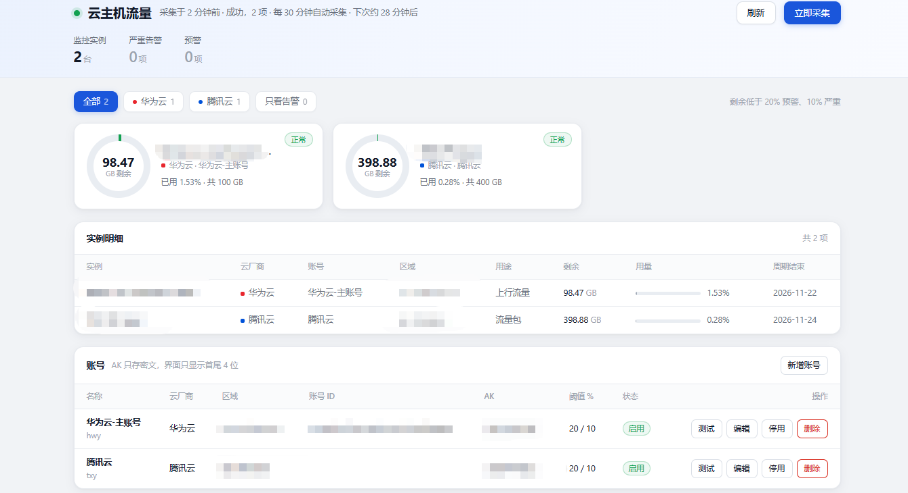

# 流量面板

> 项目标识：`flow-panel`

本项目采集华为云、腾讯云轻量应用服务器的月流量包余量，覆盖热门活动机型，在网页面板上集中展示，并对外提供 Prometheus 格式的指标端点。阿里云轻量应用服务器为不限流量套餐，未纳入实现。

项目供运维参考使用，实际额度与状态以各云厂商控制台显示为准。

单进程 Node.js 服务，无第三方依赖，数据落在本地 SQLite。默认端口 `15551`。

> 面板与采集端点均无鉴权，只应部署在内网；不要把端口映射到公网。



---

## 一、概述

### 1.1 功能

| 能力 | 说明 |
| --- | --- |
| 多云账号 | 同一面板管理多个云账号，AK/SK 加密落盘 |
| 定时采集 | 默认 30 分钟一轮，可改 5 分钟以上任意间隔，改完即时生效 |
| 余量面板 | 告警计数、余量环形卡片、实例明细表、采集记录 |
| 阈值告警 | 按「剩余百分比」分预警 / 严重两级，支持全局阈值与账号级覆盖 |
| 指标端点 | `/pull` 输出 Prometheus 文本，支持按云厂商过滤与 JSON 格式 |
| 历史保留 | 明细数据默认保留 90 天，每轮采集后自动清理 |

### 1.2 支持范围

| 云厂商 | 数据接口 | 采集内容 |
| --- | --- | --- |
| 华为云 | BSS 资源包用量、RMS 资源查询 | 独立资源包 + Flexus L 实例流量包 |
| 腾讯云 | `DescribeInstances`、`DescribeInstancesTrafficPackages` | 轻量应用服务器（Lighthouse）流量包 |

### 1.3 工作方式

服务启动后按设定间隔依次遍历启用状态的账号，调用各云厂商的只读接口取回余量，写入快照表；面板读取最新快照渲染，`/pull` 读取同一份快照输出指标。账号级失败只影响该账号，写入账号行的错误信息；单账号内部分链路失败（例如实例能列出但流量包无权限）不判定整次失败，仅在采集记录中标注。

---

## 二、部署

### 2.1 环境要求

| 项 | 要求 |
| --- | --- |
| 运行方式 | Docker 20+ 与 Docker Compose v2，或 Node.js >= 22.5（用到内置 `node:sqlite`） |
| 网络 | 容器/主机可访问云厂商 API（HTTPS 443） |
| 端口 | 默认 `15551`，需在内网可达 |
| 磁盘 | 数十 MB 起，随账号数与保留天数增长 |

### 2.2 Docker Compose 部署（推荐）

```bash
cd flow-panel

# 可选：显式指定主密钥（见 2.5）。不指定则首次启动自动生成
export MASTER_KEY=$(openssl rand -base64 32)

docker compose up -d --build
docker compose logs -f
```

启动后访问 `http://<内网IP>:15551`。

数据保存在宿主机的 `./data` 目录，容器重建不影响数据。

### 2.3 源码方式运行

```bash
cd flow-panel
node --version                      # 需 >= 22.5

DATA_DIR=./data PORT=15551 node server/index.js
```

源码方式下 `DATA_DIR` 建议显式指定，默认值为 `/data`（为容器准备）。

### 2.4 环境变量

| 变量 | 默认值 | 说明 |
| --- | --- | --- |
| `PORT` | `15551` | 监听端口 |
| `DATA_DIR` | `/data` | 数据目录，存放数据库与主密钥 |
| `MASTER_KEY` | 空 | AK/SK 加密主密钥，32 字节 base64。留空则首次启动时生成到 `$DATA_DIR/master.key` |
| `TZ` | `Asia/Shanghai` | 影响日志时间与展示时间 |

### 2.5 数据目录与备份

`$DATA_DIR` 下有两类文件，**必须一起备份**：

| 文件 | 内容 | 丢失后果 |
| --- | --- | --- |
| `panel.db`（含 `-wal`、`-shm`） | 账号、快照、采集记录、设置 | 历史数据与账号配置丢失 |
| `master.key` | AK/SK 的加密主密钥 | 已录入的 AK/SK 无法解密，只能重新录入 |

备份与恢复：

```bash
# 备份
docker compose stop
tar czf flow-panel-data-$(date +%F).tar.gz data/
docker compose start

# 恢复
docker compose stop
tar xzf flow-panel-data-YYYY-MM-DD.tar.gz   # 覆盖 data/
docker compose start
```

使用环境变量 `MASTER_KEY` 而非密钥文件时，该值同样需要妥善保管；更换主密钥会导致已存凭据全部失效。

### 2.6 网络与访问控制

服务本身不提供认证。若需通过域名访问或对外暴露，应在前置反向代理上补齐访问控制：

```nginx
location / {
    auth_basic           "traffic panel";
    auth_basic_user_file /etc/nginx/.htpasswd;
    proxy_pass           http://127.0.0.1:15551;
}
```

`/`（面板）与 `/pull`（指标）都需要可达；若由 Prometheus 抓取，请对抓取来源放行。

### 2.7 升级

```bash
docker compose up -d --build
```

数据位于卷中，升级不受影响。表结构通过 `CREATE TABLE IF NOT EXISTS` 建立，新增表会自动创建；当前不包含字段级迁移，涉及列变更的版本需手工处理。

---

## 三、使用

### 3.1 首次配置流程

1. 打开面板，进入「账号」区域，点「新增账号」。
2. 选择云厂商，填写名称、标识、区域、AK/SK。
3. 保存后点该行的「测试」，确认返回连通正常。
4. 在「采集设置」中确认采集间隔与阈值。
5. 点右上「立即采集」，稍候刷新查看数据。

### 3.2 账号字段

| 字段 | 必填 | 说明 |
| --- | --- | --- |
| 云厂商 | 是 | 选定后不可修改 |
| 名称 | 是 | 展示用名称 |
| 标识 slug | 是 | 唯一标识，小写字母、数字、短横线，最长 32 位；用于指标标签与端点过滤 |
| AK / SK | 是 | 云厂商访问密钥；编辑时留空表示不修改，已存值只显示首尾各 4 位 |
| 预警阈值 / 严重阈值 | 否 | 按剩余百分比计算；留空则沿用全局设置 |

按云厂商追加的字段：

| 云厂商 | 字段 | 必填 | 说明 |
| --- | --- | --- | --- |
| 华为云 | 区域 | 否 | 如 `cn-southwest-2`；留空则不按区域过滤 |
| 华为云 | 账号 ID | 否 | Flexus L 实例查询需要；不填只查独立资源包 |
| 腾讯云 | 区域 | 是 | 如 `ap-guangzhou`；轻量接口必须带地域 |

**腾讯云一个账号对应一个地域**，多地域请建立多个账号（标识不同）。华为云区域为空时按全部区域查询。

权限方面，账号只需只读权限，不建议使用主账号密钥：

- 腾讯云：`DescribeInstances`、`DescribeInstancesTrafficPackages`
- 华为云：BSS 资源包用量查询、RMS 资源查询

保存账号时即校验必填项，缺失会直接返回错误，不会写入无效账号。

### 3.3 连通性测试

账号行「测试」按钮使用已保存的凭据调用一次只读接口：

- 腾讯云返回「连通正常：`<区域>` 下共 N 台轻量实例」
- 华为云返回「连通正常：资源包 N 个」，填了账号 ID 时追加「，Flexus L 实例 M 个」

测试失败会在账号行显示错误原因，失败不影响其他账号。

### 3.4 采集与阈值

| 设置 | 默认 | 取值范围 | 说明 |
| --- | --- | --- | --- |
| 采集间隔 | 30 分钟 | 5 - 1440 | 保存后下一轮生效，无需重启 |
| 全局预警阈值 | 20% | 0 - 100 | 剩余低于该值标记为预警 |
| 全局严重阈值 | 10% | 0 - 100 | 剩余低于该值标记为严重 |
| 历史保留 | 90 天 | 7 - 365 | 每轮采集后清理过期明细 |

阈值以「剩余百分比」为口径，账号级设置优先于全局。可用量与总量均缺失的条目判定为「无数据」，不参与告警计数。

「立即采集」为手动触发；若上一轮尚未结束，本次请求会被跳过并提示，避免并发采集。

### 3.5 面板说明

| 区域 | 内容 |
| --- | --- |
| 顶部横幅 | 上次采集时间与结果、监控实例数、严重告警数、预警数 |
| 筛选条 | 全部 / 各云厂商 / 只看告警，点击后卡片与明细表同步过滤 |
| 余量卡片 | 环形图按「已用比例」填充，中心为剩余绝对值，附已用百分比与总量；无数据单独标记 |
| 实例明细 | 实例、云厂商、账号、区域、用途、剩余、用量、周期结束 |
| 账号 | 账号列表与增删改查、启用停用、连通性测试 |
| 采集设置 | 采集间隔、阈值、历史保留 |
| 采集端点 | `/pull` 各路径与复制按钮 |
| 最近采集 | 最近若干轮采集的时间、结果、条目数、失败原因 |

页面每 60 秒自动刷新数据；正在编辑设置或账号表单时不会覆盖已输入的内容。

### 3.6 Prometheus 接入

```yaml
scrape_configs:
  - job_name: flow-panel
    scrape_interval: 5m
    metrics_path: /pull
    static_configs:
      - targets: ["10.0.0.5:15551"]
```

抓取间隔建议不小于采集间隔，否则会重复取到同一份快照。

| 端点 | 返回 |
| --- | --- |
| `/pull` | 全部云厂商，Prometheus 文本 |
| `/pull/huawei`、`/pull/tencent` | 按云厂商过滤 |
| `/pull?format=json` | JSON，按云厂商分组 |

### 3.7 指标说明

| 指标 | 类型 | 含义 |
| --- | --- | --- |
| `cloud_traffic_remaining` | gauge | 剩余流量额度，单位见 `unit` 标签 |
| `cloud_traffic_total` | gauge | 套餐或资源包总量，单位见 `unit` 标签 |
| `cloud_traffic_used_percent` | gauge | 已用百分比 |
| `cloud_traffic_alert` | gauge | 阈值状态：0 正常，1 预警，2 严重 |
| `cloud_traffic_cycle_end_seconds` | gauge | 当前计费周期结束时间（Unix 秒） |
| `cloud_panel_last_collect_timestamp_seconds` | gauge | 最近一次采集完成时间（Unix 秒） |
| `cloud_panel_last_collect_ok` | gauge | 最近一次采集是否全部成功：1 成功，0 有失败 |
| `cloud_panel_accounts` | gauge | 账号数量，按 `provider` 分组 |
| `cloud_panel_instances` | gauge | 实例或资源项数量，按 `provider` 分组 |

业务指标的标签：`provider`、`account`、`instance`、`region`、`usage`、`unit`、`resource_id`。

数值不做单位换算，原始数值配合 `unit` 标签使用。示例告警规则：

```yaml
- alert: CloudTrafficUsedHigh
  expr: cloud_traffic_used_percent > 80
  for: 30m
  labels:
    severity: warning
  annotations:
    summary: '{{ $labels.instance }} 流量已用 {{ $value }}%'
```

---

## 四、运维

### 4.1 常见错误

| 现象 | 原因 | 处理 |
| --- | --- | --- |
| `APIGW.0301` / HTTP 401 | 华为云 AK/SK 错误或权限不足 | 核对密钥，确认具备只读权限 |
| `AuthFailure.SignatureFailure` | 腾讯云 SecretKey 错误 | 重新录入 SK |
| `UnauthorizedOperation.NoPermission` | 腾讯云子账号缺少接口权限 | 补充 Lighthouse 只读权限 |
| 采集记录提示「流量包查询失败」 | 实例可列出但流量包无权限 | 实例仍会展示并标记为未查到流量包；补齐权限后恢复 |
| 账号行提示「区域必填」 | 腾讯云账号未填区域 | 编辑账号补充地域 |
| `[entrypoint] 警告：改不了 /data 的属主` | rootless Docker 或 Podman 不允许 chown | `chown -R 1000:1000 ./data` 后重启 |

采集失败的完整原因同时写入「最近采集」与账号行，可据此定位。

### 4.2 健康检查

容器内置健康检查，每 30 秒请求一次 `/api/state`：

```bash
docker inspect --format '{{.State.Health.Status}}' flow-panel
```

也可直接验证端点：

```bash
curl -fsS http://127.0.0.1:15551/pull | head
```

### 4.3 日志

```bash
docker compose logs -f --tail=200
```

日志按 `json-file` 驱动保留，单文件 10 MB、最多 3 个。日志时间受 `TZ` 影响。

---

## 五、已知限制

- 单进程单实例，数据库为本地文件，不做多副本与高可用；多实例同时运行会争用同一数据文件。
- 面板与指标端点无鉴权，依赖网络层隔离。
- 腾讯云账号与地域一对一，多地域需多账号。
- 华为云 Flexus L 实例需填写账号 ID，否则仅能采集独立资源包。
- 指标数值不做跨厂商单位换算，消费端需按 `unit` 标签自行处理。
- 不包含数据库结构迁移机制，跨版本升级涉及列变更时需手工处理。
